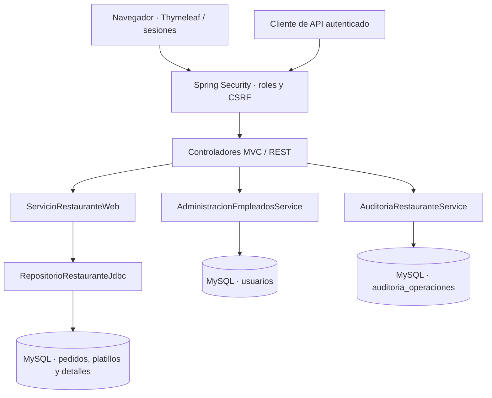

# Restaurante | Sistema de gestión de pedidos

[](https://github.com/HenryGonzalezAlguera/Proyecto-final-restaurante/actions/workflows/java-maven.yml)


**Aplicación web de gestión de pedidos para restaurantes**, desarrollada en Java, Spring Boot, Thymeleaf y MySQL. Incluye administración de platillos, flujo de preparación FIFO, dashboard operativo, API REST, control de acceso por roles y bitácora de operaciones.

> **Portfolio project · Local demo.** This Java/Spring Boot application showcases order management, JDBC transactions, role-based access control, REST endpoints, MySQL persistence, and automated tests. It is **not** a deployed SaaS or production POS.

> **Alcance:** prototipo funcional para aprendizaje y portafolio. Escucha solo en `127.0.0.1`; no incluye pagos, facturación ni reservas. **No exponerlo públicamente** sin HTTPS y revisión de seguridad.

## Vista general

| Área | Lo implementado |
| --- | --- |
| Pedidos | Registro, consulta, estados, cancelación válida y siguiente pendiente por FIFO |
| Catálogo | Alta, edición, activación y desactivación sin alterar precios históricos |
| Dashboard | Indicadores por estado, importe nominal de pedidos entregados y platillos destacados |
| Historial | Búsqueda por pedido/cliente, filtro por estado y detalle de cada orden |
| Usuarios | Roles `ADMIN`/`EMPLEADO`, alta y control de empleados, restablecimiento de claves |
| Auditoría | Registro posterior a operaciones, actor, acción, referencia y fecha; lectura solo `ADMIN` |
| Seguridad | Spring Security, BCrypt, CSRF, sesiones, revocación y límite local de intentos |
| API REST | Consulta y gestión de pedidos en JSON con sesión autenticada y CSRF |

### Capturas de pantalla

Las capturas de la interfaz todavía **no están publicadas** en este repositorio. La [guía de capturas](docs/CAPTURAS.md) detalla las seis vistas recomendadas y cómo eliminar datos privados antes de subirlas. La ausencia de imágenes no afecta el funcionamiento ni las pruebas del proyecto.

## Tecnologías

| Capa | Herramientas |
| --- | --- |
| Lenguaje y dominio | Java 17, `BigDecimal`, validaciones y estados |
| Backend | Spring Boot 4.1.2, Spring MVC, Spring Security |
| Frontend | Thymeleaf, HTML y CSS responsivo |
| Datos | MySQL 8 / JDBC / SQL parametrizado / InnoDB |
| Pruebas | JUnit 5, MockMvc y pruebas JDBC sobre MySQL de CI |
| Construcción y CI | Maven multimódulo, GitHub Actions |

## Arquitectura



El proyecto utiliza un **reactor Maven de dos módulos**:

- `Restaurante/`: entidades, ciclo de vida de pedidos y repositorio JDBC.
- `RestauranteWeb/`: controladores MVC y REST, servicios, autenticación y vistas Thymeleaf.
- `database/`: esquema, datos de demostración y migraciones incrementales.
- `docs/`: detalles técnicos, guía de pruebas y recorrido funcional.

**Decisiones relevantes:** el pedido conserva una instantánea de nombre y precio de cada platillo; el registro del pedido con sus detalles y los cambios de estado usan transacciones JDBC; el siguiente pendiente se selecciona con bloqueo y `SKIP LOCKED`. El registro de auditoría se realiza **después de la operación**, por separado, por lo que **no es transaccional** con el cambio de negocio.

[Ver arquitectura detallada](docs/ARQUITECTURA.md) · [Estados de pedidos](docs/FLUJO_PEDIDOS.md) · [Seguridad y sus límites](docs/SEGURIDAD.md)

## Ejecución local

**Requisitos:** JDK 17, Maven, MySQL 8 y acceso a phpMyAdmin o un cliente SQL. El proyecto usa por defecto el puerto `8085`.

1. Clona el repositorio y entra en la carpeta:

   ```bash
   git clone https://github.com/HenryGonzalezAlguera/Proyecto-final-restaurante.git
   cd Proyecto-final-restaurante
   ```

2. En una base **dedicada** `restaurante_portafolio`, prepara el esquema y las migraciones desde `database/` **en este orden**:

   | Archivo | Objetivo |
   | --- | --- |
   | `01_esquema.sql` | Tablas iniciales |
   | `02_datos_demo.sql` | Datos ficticios opcionales |
   | `03_migracion_catalogo.sql` | Alta de platillos con ID automático |
   | `04_usuarios_seguridad.sql` | Cuentas de acceso |
   | `05_auditoria_operaciones.sql` | Bitácora operativa |

   **Antes de migrar una base existente:** realiza un respaldo y detén Spring Boot. La migración 03 modifica temporalmente una restricción de clave foránea. Los scripts no están concebidos como un sistema automático de migraciones.

3. Crea un usuario **MySQL técnico**, distinto de las cuentas del login web, con permisos mínimos `SELECT`, `INSERT` y `UPDATE` sobre las tablas de negocio; para `auditoria_operaciones`, bastan `SELECT` e `INSERT`. Configura las variables `RESTAURANTE_DB_URL`, `RESTAURANTE_DB_USER` y `RESTAURANTE_DB_PASSWORD` en tu entorno local; nunca publiques las contraseñas. La [guía de MySQL](database/README.md) contiene el procedimiento de PowerShell.

4. Compila y ejecuta:

   ```bash
   mvn -f pom.xml clean verify
   java -jar RestauranteWeb/target/restaurante-web-1.0-SNAPSHOT.jar
   ```

5. Inicializa **una sola vez** la primera cuenta administrativa usando las variables de entorno descritas en [Seguridad — cuenta inicial](docs/SEGURIDAD.md#3-crear-primera-cuenta-administradora). No existen credenciales predeterminadas. Inicia sesión en **http://127.0.0.1:8085/login**.

> Para una demostración guiada sin datos personales, consulta [DEMO_PORTAFOLIO.md](docs/DEMO_PORTAFOLIO.md).

## Roles y permisos

| Función | `ADMIN` | `EMPLEADO` |
| --- | :---: | :---: |
| Pedidos, dashboard e historial | ✅ | ✅ |
| API de pedidos con sesión y CSRF | ✅ | ✅ |
| Crear/editar/desactivar platillos | ✅ | — |
| Administrar cuentas de empleados | ✅ | — |
| Consultar auditoría | ✅ | — |
| Consultar `GET /api/platillos` (incluye costos) | ✅ | — |

Los permisos se aplican **en el servidor**. Las contraseñas se almacenan mediante BCrypt, y las sesiones de empleados se revocan en la siguiente petición tras desactivación o cambio de hash. La limitación de intentos de login opera por IP y **solo en memoria**; no es un sistema distribuido de protección.

## API REST (JSON)

| Método | Ruta | Uso |
| --- | --- | --- |
| GET | `/api/pedidos` | Listado de pedidos |
| GET | `/api/pedidos/{id}` | Pedido y detalles |
| POST | `/api/pedidos` | Registrar pedido |
| POST | `/api/pedidos/{id}/estado` | Cambiar estado válido |
| POST | `/api/pedidos/siguiente` | Iniciar siguiente pendiente |
| GET | `/api/platillos` | Lista de platillos (solo `ADMIN`) |

```json
{
  "clienteId": 1,
  "platilloId": 1,
  "cantidad": 2
}
```

Los `POST` requieren **cookie de sesión y token CSRF**; no son endpoints públicos anónimos. El formulario web permite un tipo de platillo por pedido, aunque el módulo de dominio admite varios detalles.

## Calidad y pruebas

La ejecución `mvn -f pom.xml clean verify` construye ambos módulos. **GitHub Actions** también levanta MySQL 8.4 en un contenedor aislado `restaurante_ci` para verificar JDBC, estados, usuarios y auditoría, y utiliza MockMvc para probar rutas, roles, sesiones y CSRF.

[Consultar ejecuciones de CI](https://github.com/HenryGonzalezAlguera/Proyecto-final-restaurante/actions/workflows/java-maven.yml)

## Límites conocidos y próximas mejoras

- Aplicación **local**, sin URL de demo pública ni despliegue productivo.
- Sin pagos, caja, reservas, inventario, impuestos o facturación electrónica.
- El dashboard presenta **valor de pedidos entregados**, no ingresos efectivamente cobrados.
- Historial con filtrado en memoria; requeriría paginación SQL para grandes volúmenes.
- Auditoría **no atómica** con las operaciones, ni diseñada para requisitos forenses.
- Falta HTTPS, cookies `Secure`, limitación distribuida de intentos, observabilidad y revisión adicional antes de publicar.

## Documentación adicional

[Arquitectura](docs/ARQUITECTURA.md) · [Demo guiada](docs/DEMO_PORTAFOLIO.md) · [Capturas pendientes](docs/CAPTURAS.md) · [Dominio](docs/DOMINIO.md) · [Flujo de pedidos](docs/FLUJO_PEDIDOS.md) · [Seguridad](docs/SEGURIDAD.md) · [Configuración de MySQL](database/README.md)

---

**Proyecto de portafolio:** [HenryGonzalezAlguera](https://github.com/HenryGonzalezAlguera) · Java / Spring Boot / MySQL.
