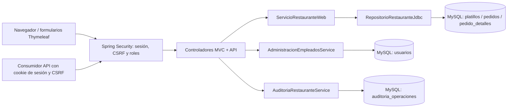
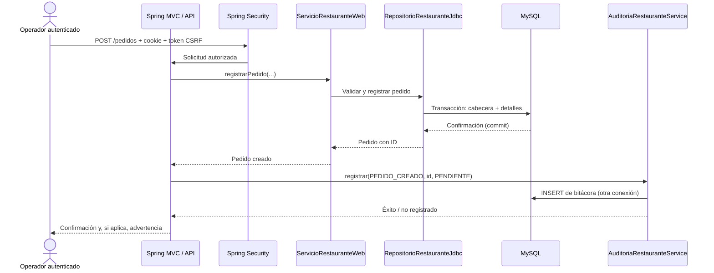

# Arquitectura técnica — Restaurante

## Propósito

Demostrar una evolución desde un modelo de dominio Java hacia una aplicación web de gestión de pedidos, sin duplicar reglas de negocio en controladores o vistas. Se trata de un **prototipo local**, no de una solución comercial desplegada.

## Módulos Maven

| Módulo | Responsabilidad | Componentes |
| --- | --- | --- |
| `Restaurante` | Dominio e infraestructura JDBC | `Pedido`, `DetallePedido`, `Platillo`, `EstadoPedido`, `GestorPedidos`, `RepositorioRestauranteJdbc` |
| `RestauranteWeb` | Adaptadores HTTP y servicios web | `ServicioRestauranteWeb`, controladores MVC/REST, Thymeleaf, Spring Security, administración de usuarios y auditoría |

Los controladores no generan SQL de pedidos. Los casos de uso reutilizan `ServicioRestauranteWeb`, y este delega la persistencia al repositorio JDBC del módulo base.

## Flujo de una operación de pedido

### Consistencia y concurrencia

- Los importes usan `BigDecimal` para evitar aritmética monetaria binaria.
- El precio y nombre del platillo se guardan como **instantánea** en `pedido_detalles`; editar el menú no revaloriza pedidos anteriores.
- La creación de pedidos utiliza una transacción para cabecera y detalles; los cambios de estado se basan en reglas del dominio y bloqueo de filas.
- El siguiente pedido pendiente se elige según FIFO usando `ORDER BY id` y `FOR UPDATE SKIP LOCKED`, para limitar la toma simultánea del mismo pedido.
- Solo se aceptan las transiciones documentadas en [FLUJO_PEDIDOS.md](FLUJO_PEDIDOS.md).

### Auditoría: limitación explícita

`AuditoriaRestauranteService` registra los eventos **después** de la operación principal con una conexión independiente. Por tanto, un evento puede perderse aunque el pedido o platillo se haya guardado correctamente. El sistema informa el fallo de auditoría, pero no revierte operaciones ya confirmadas. Para garantías fuertes, el evento deberá insertarse en la **misma transacción** que la operación de dominio; no debe presentarse esta bitácora como un registro forense.

## Identidad y seguridad

- `UsuariosRestauranteService` carga usuarios y hashes BCrypt desde MySQL.
- `SeguridadRestauranteConfiguracion` aplica autenticación a todas las rutas privadas, autorización por roles y protección CSRF.
- `VigenciaSesionRestauranteFiltro` consulta vigencia de cuenta y huella del hash en cada petición autenticada real. Una cuenta desactivada o con clave cambiada invalida su sesión en la **siguiente petición**.
- `ControlIntentosLogin` limita **en memoria** los fallos por IP remota, no distribuidos ni persistentes entre reinicios.
- `ADMIN`: catálogo, cuentas, auditoría, pedidos; `EMPLEADO`: pedidos, dashboard, historial y API de pedidos.

Las credenciales MySQL técnicas **no** equivalen a las cuentas de acceso web. Las contraseñas no se incluyen en el repositorio.

## Pruebas

| Tipo | Estrategia |
| --- | --- |
| Unitarias | Entidades, validación, estados, FIFO, cálculos del dashboard y límite de login |
| Web | MockMvc para HTML, API REST, rutas, permisos, CSRF y sesiones |
| Integración | JDBC y MySQL aislado `restaurante_ci` para transacciones, usuarios, revocación y auditoría |
| CI | GitHub Actions ejecuta Maven para ambos módulos en cada PR y `main` |

## Límites del prototipo

No hay frontend SPA, cola de mensajes, servicios distribuidos, sistemas de pago, autenticación de clientes externos con tokens ni despliegue por Internet. `server.address=127.0.0.1` restringe la interfaz al equipo local. Un despliegue real requeriría HTTPS, secretos gestionados, refuerzo frente a ataques de autenticación, auditoría atómica, métricas, respaldos automatizados y revisión de seguridad.
